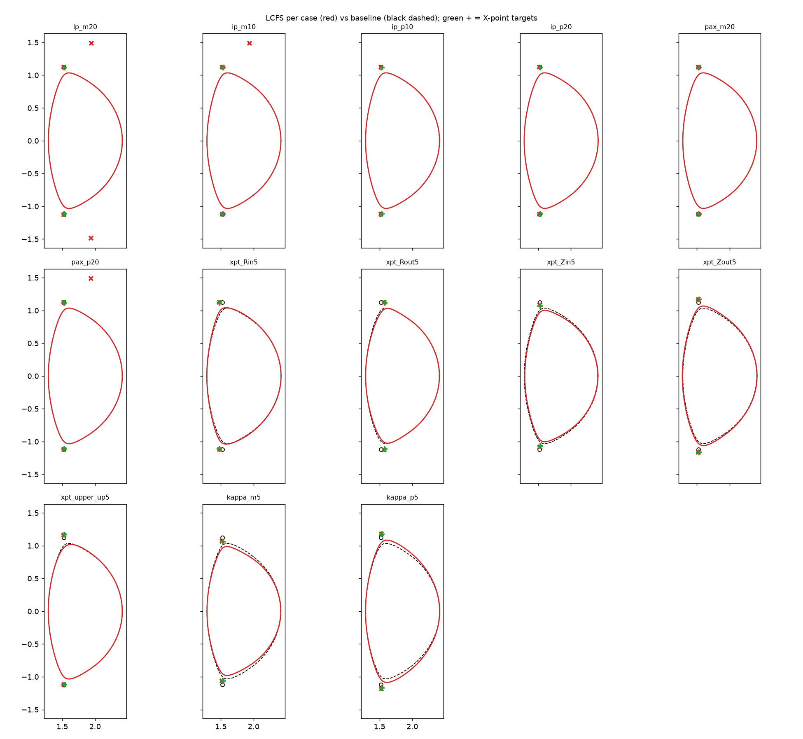
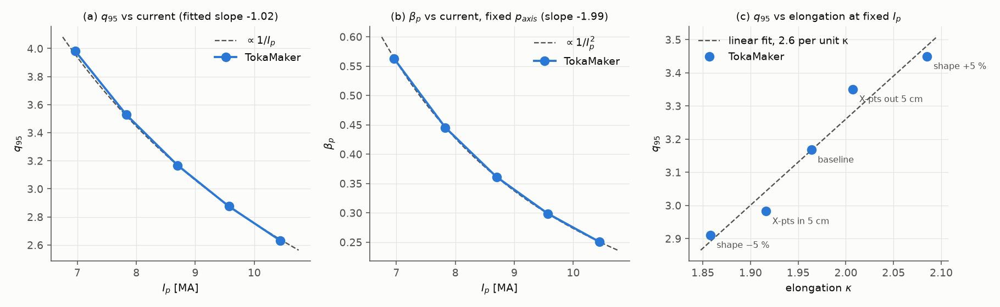

# SPARC static equilibria: what changes when you change one thing

A small learning study with TokaMaker. Starting from the public SPARC Primary Reference Discharge
(PRD), I changed one input at a time and recorded how the free-boundary equilibrium responded.
All inputs are public. How to reproduce everything is in [README.md](README.md).

## Summary

- **All 14 cases converged** (19–22 nonlinear iterations each). None looked close to failing.
- **Plasma current sets q95, and β_p at fixed pressure.** q95 ∝ Ip^−1.02 and β_p ∝ Ip^−1.99,
  essentially the textbook 1/Ip and 1/Ip² scalings. The plasma shape barely moves, because the
  shape targets pin it.
- **X-point position sets the shape.** Moving the X-points 1 cm inward raises triangularity by about
  0.015. Moving them away from the midplane makes the plasma taller and raises q95.
- **Elongation buys q95.** Across the shape cases, q95 rises by about 2.6 per unit of elongation at
  fixed current. Moving the X-points changes q95 more per unit of elongation than stretching the
  whole boundary does.
- **Lower current or higher pressure creates a second magnetic null** in the outer divertor region.
  That is directly relevant to snowflake and X-divertor ideas.
- **Coil limits could not be checked.** SPARC's coil limits are not public. "Converged" here does
  not mean "the real coils could do it".

## Starting point

- **Example:** the upstream OpenFUSIONToolkit SPARC example (OFT PR #317), solved with
  TokaMaker 26.9.
- **Target:** CFS's public double-null PRD equilibrium (SPARCPublic,
  `2 - SPARC_DN_PRD_freegs_20221013`).
- **What stays fixed in every case:**
  - Ip and on-axis pressure are hard targets.
  - The published boundary is used as soft shape targets, with the two X-points as saddle targets.
  - The pressure and current profile *shapes* come from the published equilibrium.
- **Solver settings:** coils are pulled gently toward zero current, and the two in-vessel
  vertical-stability coils act as a feedback pair.

| | TokaMaker baseline | Published (FreeGS) |
|---|---|---|
| Ip [MA] | 8.70 | 8.70 |
| q95 | 3.17 | 3.01 |
| q0 | 0.95 | 0.94 |
| elongation κ | 1.96 | 1.95 |
| magnetic axis R [m] | 1.891 | 1.890 |

Other baseline values:
- **Shape:** triangularity δ = 0.57; X-points at (1.52, ±1.12) m.
- **Plasma:** l_i = 1.28, β_p = 0.36, β_N = 0.81.

The ~5 % q95 difference is already present in the upstream example. It most likely reflects the
different codes and how each traces the edge of a diverted plasma.

## Cases

Each case starts from the baseline and changes one input:

| Case | Change |
|---|---|
| `ip_m20`, `ip_m10`, `ip_p10`, `ip_p20` | Ip target × 0.8, 0.9, 1.1, 1.2 |
| `pax_m20`, `pax_p20` | on-axis pressure target × 0.8, 1.2 |
| `xpt_Rin5`, `xpt_Rout5` | both X-point targets moved 5 cm inward / outward in R |
| `xpt_Zin5`, `xpt_Zout5` | both X-point targets moved 5 cm toward / away from the midplane |
| `xpt_upper_up5` | only the upper X-point target moved up 5 cm |
| `kappa_m5`, `kappa_p5` | whole boundary (and X-point targets) squashed / stretched 5 % in Z |

The full results table is in [results/summary.md](results/summary.md). Coil currents per case are in
[results/coil_currents.md](results/coil_currents.md). A plot for each case against the baseline is in
`results/<case>.png`.

## Findings and analysis

### 1. Plasma current mainly changes q95

| Ip | 6.96 MA (−20 %) | 7.83 MA | 8.70 MA (baseline) | 9.57 MA | 10.44 MA (+20 %) |
|---|---|---|---|---|---|
| q95 | 3.98 | 3.53 | 3.17 | 2.87 | 2.63 |
| β_p | 0.56 | 0.45 | 0.36 | 0.30 | 0.25 |

**Why.** q is roughly (toroidal field × shape factor) / poloidal field. The poloidal field scales with
Ip, and here the toroidal field and the shape are both held fixed. So q95 ∝ 1/Ip, and the fit gives
an exponent of −1.02. q95 × Ip stays within 1 % across the scan (27.5 to 27.7 MA).

**What it means.** Raising current to 10.4 MA brings q95 down to 2.6, close to the q95 ≈ 2–2.5 range
where disruption risk climbs. That is why current is the main performance knob, and also the main
risk.

**β_p falls as 1/Ip².** β_p compares plasma pressure to the poloidal field's pressure, which scales as
Ip². The pressure target was held fixed, so the fit gives −1.99.

**l_i barely moves (1.27–1.30).** l_i (internal inductance) measures how peaked the current profile
is. The profile shape was held fixed, so l_i stays put.

**Coils.** The central solenoid and the large outer PF4 coils take the biggest changes, about
±4 MA-turns at ±20 % current. More current needs a stronger vertical field to hold the plasma
radially. The total coil effort (sum of |MA-turns|) goes from 60 to 94 MA-turns across the scan.

### 2. Pressure changes β_p and little else

±20 % pressure gives β_p × 0.80 and × 1.20, with stored energy changing by the same factor. q95 moves
by less than 0.01. With the shape pinned, pressure mostly changes how much vertical field is needed,
which shows up as small PF and divertor coil changes (≤ 0.12 MA-turns).

### 3. X-point position controls triangularity and height

| Case | Δκ | Δδ | Δq95 |
|---|---|---|---|
| X-points 5 cm inward | −0.00 | +0.06 | +0.12 |
| X-points 5 cm outward | −0.01 | −0.09 | −0.09 |
| X-points 5 cm toward midplane | −0.05 | −0.00 | −0.19 |
| X-points 5 cm away from midplane | +0.04 | −0.03 | +0.18 |
| upper X-point only, 5 cm up | −0.04 | −0.08 | −0.03 |

**Accuracy.** X-point targets are soft, so they compete with the boundary targets and the coil
regularisation. The solved X-points sit 0.5–1.9 cm from their targets (about 1 cm even in the
baseline). A requested 5 cm move produced an actual move of 3.9–4.6 cm. The solver gives up a little
X-point accuracy to keep the rest of the boundary on target, and gives up the most when the X-points
are pulled toward the midplane (3.9 cm of 5).

**Triangularity.** δ is set by how far inboard the X-point sits, so δ changes by about 0.015 per cm
of radial X-point shift. Higher triangularity also raises q95: a more D-shaped plasma has longer field
lines per poloidal turn.

**Which coils do the work.** The divertor coils (DV1/DV2) and the inner PF coils carry most of the
change, up to about 1 MA-turn. That is what they are for.

**Upper X-point only.** Moving just the upper X-point breaks the up-down balance, and the lower
X-point becomes the active one. In a real machine this decides which divertor takes most of the heat.
In the balanced baseline the two X-points match to within 1 mm, so small coil changes can tip the
balance either way.

### 4. Elongation buys q95, and how you elongate matters

Stretching the whole boundary by ±5 % gives κ = 2.09 / 1.86 and q95 = 3.45 / 2.91. Across all five
shape cases, the fitted slope is 2.6 per unit of κ (panel c).

The X-point cases fall off that line on opposite sides:
- **Moving the X-points** gives about 4 per unit of κ (3.9 inward, 4.2 outward).
- **Stretching the whole boundary** gives about 2.4 per unit of κ (2.4 squashed, 2.3 stretched).

Most of q95 is set by the flux surfaces near the X-points, where field lines linger. So moving the
X-points themselves changes q95 more for the same change in overall elongation.

**Trade-off.** Higher elongation means higher q95 at the same current, or more current at the same
q95. But taller plasmas are more vertically unstable. A static solve cannot show that, because the
feedback coils just hold the plasma in place. A linear stability check (see Next steps) would.

The coil effort numbers point the other way from what you might guess: the taller shape needed less
total coil current (69 vs 77 MA-turns) and the squashed one more (87). These coils, and how strongly
the solver pulls each one toward zero, favour a shape near or above the baseline elongation. This
total is a crude measure dominated by the central solenoid, so treat it as a hint only.

### 5. A second null appears at lower current or higher pressure

At −10 % and −20 % current, and at +20 % pressure, TokaMaker finds an extra field null at about
(1.94, ±1.49) m. It sits in the outer divertor region, about 0.5 m from the main X-points and outside
the plasma.

**Why.** With less plasma current, or relatively more vertical field to balance pressure, the field
from the coils matters more near the divertor coils. Somewhere there the plasma's poloidal field and
the coils' field cancel, which makes a null.

**What it does here.** It does not change the plasma's topology or shape in these cases.

**Why it matters for this project.** Snowflake and X-divertor designs deliberately bring a second null
close to the main X-point, or into the outer divertor leg, to spread the exhaust heat. That this
appears for free at lower current suggests SPARC's coil set can make such a null. The next question
is how much divertor-coil current it takes to pull it close to the X-point.

## Caveats

- **No coil limits.** The public SPARC device description gives power supplies by name only, and its
  README says the turn counts are "toy data". Coil currents here are only indicative.
- **Static solves have no history.** The central solenoid current is just what the solver's pull
  toward zero prefers. It says nothing about flux swing or pulse length.
- **δ and κ have about ±0.02 measurement noise in this double null.** OFT reports δ_upper = 0.590 and
  δ_lower = 0.552 in the baseline, even though the two X-points mirror each other to within 1 mm.
  Changes in δ smaller than about 0.02, such as those in the current and pressure cases, are not
  meaningful. X-point coordinates are the reliable shape measure.
- **Profile shapes are fixed.** Real changes in current or pressure would also reshape the profiles.
  That would change l_i, which in turn changes how hard the plasma is to keep vertically stable.
- **Steps were small (5 cm, ±20 %).** Everything converged easily, so this scan does not show where
  the solver or the coil set reaches its limits.

## Next steps

1. **Push further.** Use larger steps (±40 % current, ±15 cm X-point moves) to find where solves
   fail or coil currents become unreasonable.
2. **Check vertical stability.** Run TokaMaker's linear stability calculation
   (`compute_linear_stability`) on the elongation cases to see the growth-rate cost of the q95 gain.
3. **Try a snowflake.** Add a second saddle target at the secondary null and walk it toward the main
   X-point, recording divertor-coil currents.
4. **Add coil limits** if a public source turns up. The script has an empty `COIL_LIMITS` slot ready.

## Acknowledgement

The information, data, or work presented herein builds on the SPARC primary reference discharge and
X-point target discharge data provided by Commonwealth Fusion Systems.
