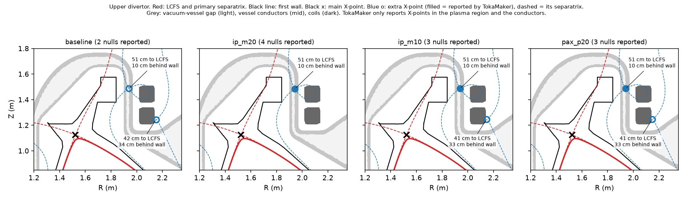

# The "second null" in the SPARC static scan is a far-field saddle, not a plasma null

**Short answer.** The extra null that TokaMaker reports in `ip_m20`, `ip_m10` and `pax_p20` is not near
the plasma. In every case it sits at (1.94, ±1.49) m:
- about 10 cm behind the first wall, in the vacuum-vessel wall, next to the DV1 divertor coil;
- 51 cm from the LCFS;
- 55 cm from the main X-point;
- 21 cm from the nearest point of the primary separatrix inside the wall (the outer divertor leg).

It is a saddle of the coil field, and it exists in **all 14 cases**, the baseline included. It does not
"appear" at lower current. It moves by a few millimetres and crosses into a mesh region where TokaMaker
reports X-points. No field line in the plasma or the scrape-off layer reaches it. It tells us nothing
about whether SPARC's coils can make a snowflake.

How this was checked: [secondary_nulls.py](secondary_nulls.py). Full table:
[results/secondary_nulls.md](results/secondary_nulls.md). Raw numbers:
[results/secondary_nulls.json](results/secondary_nulls.json).

## Method

Each case was re-solved exactly as in [sparc_static_scan.py](sparc_static_scan.py), one case per
process. The setup and solve are shared code, so results are bit-identical to the scan.

1. **PR #403 metrics.** Ran `compute_divertor_metrics` from OpenFUSIONToolkit PR #403 ("TokaMaker: Add
   divertor geometry metrics", fork commit `d567ae8`). For every X-point TokaMaker reports, it gives:
   - ψ_n;
   - whether the point is inside the wall;
   - its distance to the wall;
   - where its separatrix crosses the outboard midplane.

   The PR is not in the pinned OFT 26.9 wheel. Its `divertor.py` is pure Python and only uses
   equilibrium methods that 26.9 already has. So that one file is downloaded at the fixed commit
   (SHA-256 checked) and loaded on its own. No pins change.
2. **Distances to the plasma.** Added distances from each null to:
   - the LCFS;
   - the primary separatrix, using all its branches inside the wall;
   - the nearest main X-point.

   Also recorded |B_p| at the null, a saddle check (sign of the ψ Hessian), and which mesh region the
   null sits in.
3. **Independent search.** Searched for nulls over the whole mesh: local minima of |B_p| on a 1 cm grid,
   refined by least squares. This finds nulls whether or not TokaMaker reports them.

## Case by case

Extra nulls near the upper and lower outer divertor (the DV1 saddle). "Reported" means TokaMaker's
`get_xpoints()` lists it.

| case | upper null (R, Z) [m] | reported? | lower null (R, Z) [m] | reported? | to LCFS [cm] | behind wall [cm] | to main X-pt [cm] | to separatrix [cm] | ψ_n |
|---|---|---|---|---|---|---|---|---|---|
| baseline | (1.940, +1.487) | no | (1.933, −1.489) | no | 51 | 9–10 | 55 | 21 | 1.07 |
| **ip_m20** | (1.943, +1.484) | **yes** | (1.941, −1.485) | **yes** | 51 | 10 | 55 | 22 | 1.07 |
| **ip_m10** | (1.940, +1.486) | **yes** | (1.936, −1.488) | no | 51 | 10 | 55 | 21 | 1.07 |
| ip_p10 | (1.939, +1.488) | no | (1.931, −1.491) | no | 51 | 9–10 | 55 | 20–21 | 1.07 |
| ip_p20 | (1.938, +1.489) | no | (1.930, −1.492) | no | 51 | 9–10 | 55 | 20–21 | 1.07 |
| pax_m20 | (1.939, +1.488) | no | (1.931, −1.491) | no | 51 | 9–10 | 55 | 20–21 | 1.07 |
| **pax_p20** | (1.940, +1.486) | **yes** | (1.936, −1.488) | no | 51 | 10 | 55 | 21 | 1.07 |
| xpt_Rin5 | (2.005, +1.438) | no | (1.997, −1.438) | no | 50 | 16 | 61 | 49 | 1.20 |
| xpt_Rout5 | (1.860, +1.556) | no | (1.849, −1.559) | no | 53 | 1–2 | 52 | 17–18 | 0.95 |
| xpt_Zin5 | (2.008, +1.486) | no | (2.015, −1.485) | no | 57 | 17 | 63 | 24 | 1.14 |
| xpt_Zout5 | (1.863, +1.475) | no | (1.849, −1.476) | no | 43 | 1–2 | 45–46 | 28 | 1.03–1.04 |
| xpt_upper_up5 | (1.869, +1.470) | no | (1.929, −1.489) | no | 47 / 51 | 3 / 9 | 46 / 55 | 47 / 20 | 1.05–1.07 |
| kappa_m5 | (1.930, +1.519) | no | (1.924, −1.526) | no | 59–60 | 8–9 | 61 | 9–11 | 1.02–1.03 |
| kappa_p5 | (1.972, +1.454) | no | (1.978, −1.459) | no | 45 | 13–14 | 52–53 | 43 | 1.10–1.11 |

Every case also has a second pair of saddles near (2.15, ±1.24) m, beside the DV2 coil: 39–47 cm from
the LCFS and 33–38 cm behind the wall. TokaMaker never reports this pair, because it sits in the air
region at the DV2 coil edge. The other 16–23 nulls on the mesh are either extrema inside coils (CS, PF, DV) or saddles
further out (up to 2 m from the plasma). None of them is inside the first wall in any case.

## Why it "appears" only in three cases

TokaMaker searches the whole mesh for nulls, but only reports those in regions marked `allow_xpoints`.
In the SPARC mesh those are:
- **reported:** the plasma region and the conductors (`VESSEL_INNER`, `VESSEL_OUTER`, the VS covers);
- **not reported:** the vacuum gaps (`VAC_VESSEL`, `VAC_INNER`), the air, and the coils.

In the baseline, the DV1 saddle sits in the `VAC_VESSEL` gap, right on its boundary with `VESSEL_OUTER`
(R ≈ 1.94 m). Lower Ip or higher pressure moves it outward by 1–3 mm, into `VESSEL_OUTER`. There
TokaMaker starts reporting it. That explains why:
- `ip_m10` and `pax_p20` report only the upper null, whose small up-down asymmetry puts it just across
  the boundary;
- `ip_p10`, `ip_p20` and `pax_m20` report none, because the null moves slightly the other way.

The physical change across the Ip and pressure cases is a shift of a few millimetres. It is not the
creation of a null.

## Why it is not "near the plasma"

- **Outside the wall.** PR #403 marks every extra null `inside_wall = False`, so it traces no divertor
  legs from them. For each primary strike point, the nearest other X-point inside the wall is the
  opposite main X-point, 2.2–2.7 m away.
- **Magnetically beyond the whole SOL.** At the outboard midplane, the wall is only 6–16 mm outside the
  separatrix (ψ_n = 1.02–1.04 at the wall). In the Ip and pressure cases the DV1 null has ψ_n ≈ 1.07,
  so its flux surface is outside the wall at the midplane. No SOL field line that starts inside the wall
  at the outboard midplane passes the null. The one exception to this flux argument is `kappa_m5`,
  where the null's ψ_n of 1.02–1.03 matches a flux surface 7–11 mm into the SOL. Even there the null is
  8–9 cm behind the wall, so field lines on that surface hit the divertor target before reaching it.
  In `xpt_Rout5` the null has ψ_n ≈ 0.95, but that only means it shares the flux value of a core
  surface. It lies in a separate region behind the wall.
- **Far in space.** 51 cm from the LCFS and 55 cm from the main X-point, about as far from the X-point
  as the minor radius (a ≈ 0.57 m). A snowflake or X-divertor needs the second null within a few cm of
  the main X-point, or on the divertor leg inside the chamber.

## What this changes in the report

- Finding 5 in [REPORT.md](REPORT.md) and the matching notes in [README.md](README.md) are corrected.
  The null is not created by lower current or higher pressure, and it is not in the divertor chamber.
- The "second null comes for free" argument for a snowflake does not hold. A snowflake study (next
  step 3) would have to pull this saddle about 50 cm, from behind the wall to the main X-point. That is
  a much bigger ask of the DV coils than the report implied.
- The scan's main X-point table is unaffected: it already picks the null nearest each saddle target.

## Caveats

- **Mesh-limited accuracy.** B comes from the gradient of the order-2 finite-element ψ, which jumps
  slightly across element edges. A null that lies on an element edge only refines to about 1–2 mT,
  against about 0.4 T nearby (baseline upper DV1 saddle: 1.8 mT). These nulls are accepted with
  |B_p| < 5 mT. Positions are good to about 1 cm, the grid spacing used to seed the search.
- **Saddle check at coil edges.** The finite-difference saddle check can misclassify a saddle that sits
  on a coil edge. In `ip_m20` this drops the upper DV2 saddle at (2.14, +1.25) m from the table. It is
  far from the plasma either way.
- **"Behind the wall" uses the limiter contour in the TokaMaker mesh** (`lim_contours`), the same wall
  PR #403 uses by default.
