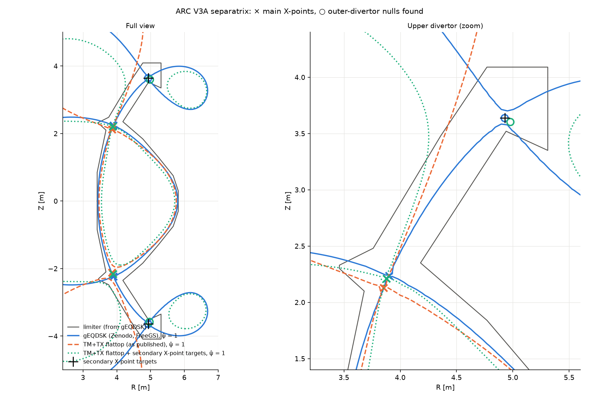
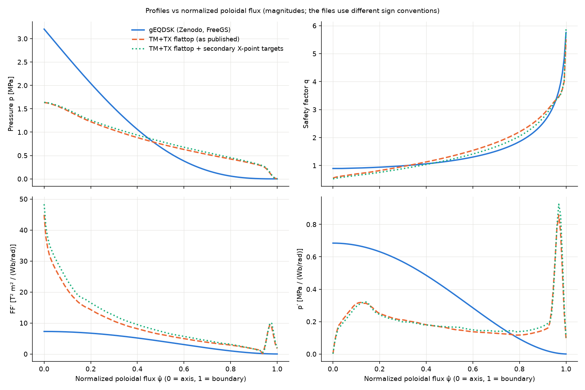
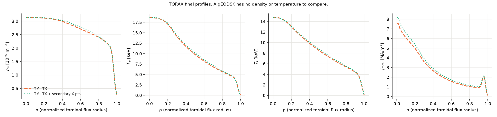
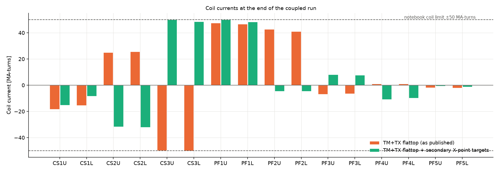

# ARC V3A: TokaMaker+TORAX flattop vs the public gEQDSK

## Question

Freddie's TokaMaker+TORAX (TM+TX) notebook produces an ARC V3A flattop in which TORAX predicts the plasma
profiles. How close is that to the public ARC V3A reference equilibrium (the gEQDSK on Zenodo)? And
where they differ, why?

## What was compared

**The public gEQDSK.** A FreeGS equilibrium from the ARC V3A design (Zenodo 19498373). Its pressure and
current profiles are fixed inputs, and its shape comes from FreeGS's own coil solution.

**The TM+TX flattop.** Freddie's public notebook, Section 1, run unchanged on TORAX 1.4.3 (see README for
the small patches and why 1.4.3).
- TokaMaker solves the equilibrium shape. Its targets come from a = 1.18 m, κ = 1.8 and δ = 0.65, not
  from the gEQDSK boundary.
- TORAX evolves density, temperatures and current. It uses the QLKNN transport model, a 4.5 keV
  pedestal, 50 MW of ICRH and a gas puff, with no sawteeth.
- The two codes iterate to a steady state.

The run reproduced Freddie's saved run:

| | This run | Freddie's saved run |
|---|---|---|
| Q | 10.2 | 10.4 |
| Fusion power | 522 MW | 533 MW |
| H98 | 0.75 | 0.75 |
| ⟨n_e⟩ | 2.47e20 m⁻³ | 2.48e20 m⁻³ |
| ⟨T_e⟩ | 7.9 keV | 7.9 keV |

At the end, TokaMaker and TORAX agree on flux consumption to 0.25 %.

Both equilibria were saved as gEQDSK files on the same grid and measured by the *same* code. That code
reproduces TokaMaker's own numbers to about 1 % (volume and q95 exactly), and the gEQDSK's plasma current
to 0.04 %.

## Results (observed)

| | gEQDSK | TM+TX | Difference |
|---|---|---|---|
| Ip, field at 4.62 m | 12.0 MA, 11.4 T | 12.0 MA, 11.4 T | same by construction |
| q95 | 3.20 | 3.29 | +3 % |
| Elongation κ | 1.84 | 1.78 | −4 % |
| Minor radius a | 1.18 m | 1.14 m | −3 % |
| Volume | 194 m³ | 183 m³ | −6 % |
| δ from X-points | 0.61 | 0.67 | +0.06 |
| X-points | (3.90, ±2.24) m, both at ψ̂ = 1.000 | (3.85, +2.13) at ψ̂ = 1.000; (3.85, −2.12) at ψ̂ = 1.016 | 12 cm apart |
| Second null in outer divertor | **yes**, (4.93, ±3.64) m at ψ̂ = 0.999 | **no** (B_p ≥ 0.33 T there) | |
| Axis pressure | 3.20 MPa | 1.63 MPa | −49 % |
| Volume-average pressure | 0.72 MPa | 0.63 MPa | −13 % |
| β_N | 1.56 | 1.32 | −15 % |
| q0 | 0.89 | 0.55 | −0.34 |
| l_i | 1.34 | 0.95 | −29 % |

## What it means (interpretation)

1. **The global operating point matches; the details don't.** Ip and field are the same by
   construction, and q95 is within 3 %. So at the level of "a 12 MA, 11.4 T, q95 ≈ 3.2 double null",
   the two agree.

2. **The shape differs because the shape targets differ, not because of TORAX.** The TM+TX X-points land
   exactly on their moment-based targets, (3.853, ±2.124) m. The gEQDSK's X-points are at
   (3.901, ±2.236) m, 12 cm higher. Hand-placed targets of (3.9, ±2.2) m elsewhere in this project are
   close to the gEQDSK's values. With lower X-points, the TM+TX plasma is shorter (κ 1.78) and 6 %
   smaller in volume.

3. **The pressure profile is where TORAX really differs.**
   - **TORAX's profile is broad,** with an H-mode pedestal. The gEQDSK's is strongly peaked, with twice
     the axis pressure.
   - **TORAX has about 13 % less pressure on average,** so β_N is 1.32 against 1.56. Some of that gap
     comes from TORAX's smaller plasma; the rest is profile shape and pedestal height.
   - **The sharp p′ and FF′ spikes near ψ̂ ≈ 0.97** in the TM+TX profiles are the pedestal and its
     bootstrap current. The gEQDSK has no pedestal.

4. **q0 = 0.55 in TM+TX is expected for this setup, and isn't realistic.** Sawteeth are switched off in
   the notebook, so the core current keeps peaking until q0 is well below 1. A real plasma, or TORAX with
   sawteeth on, would hold q0 near 1, close to the gEQDSK's 0.89. The l_i gap (0.95 vs 1.34) comes from
   the same different current profile. (TORAX also reports l_i3 = 0.74, a different definition of l_i,
   so don't compare that number directly.)

5. **For advanced divertors, the biggest difference is in the divertor.** The public gEQDSK already has
   a second null in each outer divertor, at (4.93, ±3.64) m, almost exactly on the separatrix
   (ψ̂ = 0.999). That makes it an X-point-target / X-divertor-like magnetic geometry. The TM+TX flattop
   only asks for the two main X-points, and it has no second null: its divertor legs run straight out.
   Its final state also leans slightly toward the upper X-point, with the lower one 1.6 % of the flux
   outside the boundary. **So the TM+TX flattop, as set up, does not keep the advanced-divertor geometry
   that the reference equilibrium has.**

## Experiment: add the secondary X-points to the TM+TX run

**What changed.** One input: saddle (null) targets at the gEQDSK's outer-divertor nulls,
(4.93, ±3.64) m. They were added to the starting equilibrium and to the coupled loop, through OFT's
`set_diverted_shape_targets(secondary_x_point_targets=...)`, with the same weight as the main
X-points. Everything else is identical to the run above (`run_flattop.py --case secondary_xpoints`).

**What OFT's workflow asks for.** This option asks only that the field be zero at those points. Unlike
the shape-testing notebook, it does *not* also ask that the points lie on the separatrix.

### Observations

| | gEQDSK | TM+TX | TM+TX + secondary X-pts |
|---|---|---|---|
| Outer-divertor null | (4.93, ±3.64) m, ψ̂ = 0.999 | none (B_p ≥ 0.33 T) | (4.98, +3.60) and (4.96, −3.57) m, ψ̂ = 1.08 / 1.10 |
| Upper / lower main X-point ψ̂ | 1.000 / 1.000 | 1.000 / 1.016 | 1.000 / 1.032 |
| Upper main X-point | (3.90, +2.24) | (3.85, +2.13) | (3.88, +2.21) |
| Minor radius a, volume | 1.18 m, 194 m³ | 1.14 m, 183 m³ | 1.08 m, 167 m³ |
| Elongation κ (from boundary) | 1.84 | 1.78 | 1.88 |
| Q, fusion power, H98 | — | 10.2, 522 MW, 0.75 | 10.0, 512 MW, 0.72 |
| Coils at the ±50 MA-turn limit | — | CS3U, CS3L | CS3U, PF1U (CS3L, PF1L within 3 %) |
| Coupling after 3 loops: loop-to-loop change, TM vs TX flux | — | 2.5 %, 0.25 % | 7.3 %, 0.94 % |

Notes on the observations:
- **All runs solved.** Every TokaMaker solve converged in both runs (5/5 per loop).
- **The secondary run is less settled.** After the same three coupling loops it has not converged as
  far as the run without the targets.
- **The κ check differs here.** For this case my boundary-measured κ (1.88) differs from TokaMaker's
  (2.02). TokaMaker measures height to the lower X-point even when that X-point sits outside the
  boundary (ψ̂ = 1.032); my measurement stops at the boundary. The other checks agree within about 1 %.

### Interpretation

1. **Asking for the nulls creates them, but not the reference geometry.** Nulls now appear within
   about 7 cm of the targets. But they sit at ψ̂ ≈ 1.08–1.10, out in the scrape-off layer, while the
   gEQDSK's are on the separatrix (0.999). A null 8–10 % of the flux outside the boundary does not
   split the main exhaust lane the way an X-divertor does. The separatrix plot shows lobes like the
   gEQDSK's, but the main separatrix doesn't pass through the new nulls.

2. **The coils are near their limits.** Even without secondary targets, CS3 sits at the notebook's
   ±50 MA-turn bound. With them, CS3U and PF1U hit the bound and CS3L and PF1L are within 3 %. The solver
   pays for the new nulls partly by giving up plasma size: the volume drops 9 % and the plasma leans
   further toward the upper X-point.

3. **Individual coil changes aren't reliable evidence.** CS2 and CS3 flip sign between the two runs
   (CS3 from −50 to +50 MA-turns). The shape-target study saw the same kind of near-cancelling coil
   combination. So the change in any single coil is not a reliable measure of what the secondary null
   costs. The fact that the bounds are reached *is* meaningful.

4. **What this suggests for the research question (speculative, not yet tested).** With these coil
   bounds and saddle-only targets, the coupled TM+TX flattop does not reproduce the reference
   X-divertor-like geometry. It is not clear yet whether that is because:
   - **the constraints are missing:** nothing asks for the null to sit on the separatrix;
   - **the coil limits are too tight:** the bounds are binding;
   - **the profiles are different:** TORAX's broader pressure and current change the field the coils
     must supply.

   The next tests below are designed to separate these.

## Caveats

- **Different inputs on purpose.** This compares two equilibria made with different shape targets and
  profile sources. It is not a code-vs-code benchmark with matched inputs.
- **TORAX version.** The TM+TX run uses TORAX 1.4.3 (needed by the notebook). The repo pin is 1.4.0,
  and 1.4.3 changes the ITER example's L-H time a lot (see README). The size of version effects on
  this flattop is not known.
- **Simplified pulse.** Freddie's notebook says this flattop simplifies the reference pulse: it uses
  one pedestal temperature, a prescribed gas puff, and no sawteeth.

## Next steps

1. **Match the shape** (most useful): give TM+TX the gEQDSK boundary and X-points (3.90, ±2.24) as
   targets. Remaining differences would then come from the profiles alone.
2. **Turn sawteeth on** and check that q0 settles near 1.
3. ~~Add the secondary X-points as TM+TX targets~~ (done, see the experiment above).
4. **Put the secondary nulls on the separatrix**, not just at zero field. Add isoflux points there,
   as the shape-testing notebook does. OFT's workflow has no option for this yet; its
   `strike_point_targets` are isoflux points and could be used for it.
5. **Separate the coil-limit effect from the profile effect:**
   - rerun with looser coil bounds (as a diagnostic, not as a design claim);
   - solve the secondary-null case in static TokaMaker with the gEQDSK's own profiles.

## Questions for Freddie

1. Should the TM+TX flattop use the Zenodo gEQDSK's boundary and X-points as its shape targets, rather
   than the moment-based ones? Its X-points (3.85, ±2.13) are 12 cm from the gEQDSK's (3.90, ±2.24).
2. Is the gEQDSK's secondary null at (4.93, ±3.64), sitting at ψ̂ = 0.999, the intended ARC V3A divertor
   configuration? If so, should the TM+TX runs include it as a target?
3. Which TORAX version should the project standardize on? 1.4.3 runs your notebook but moves the ITER
   example's L-H time from about 136 s to about 81 s.
4. With secondary X-point targets, the coupled run makes the nulls but leaves them at ψ̂ ≈ 1.08–1.10,
   and CS3/PF1 hit the ±50 MA-turn bound. Are ±50 MA-turns the intended ARC V3A coil limits? And
   should the secondary nulls also be isoflux targets in the coupled workflow?
