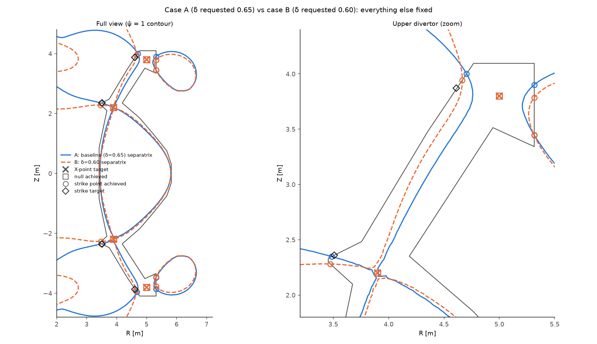
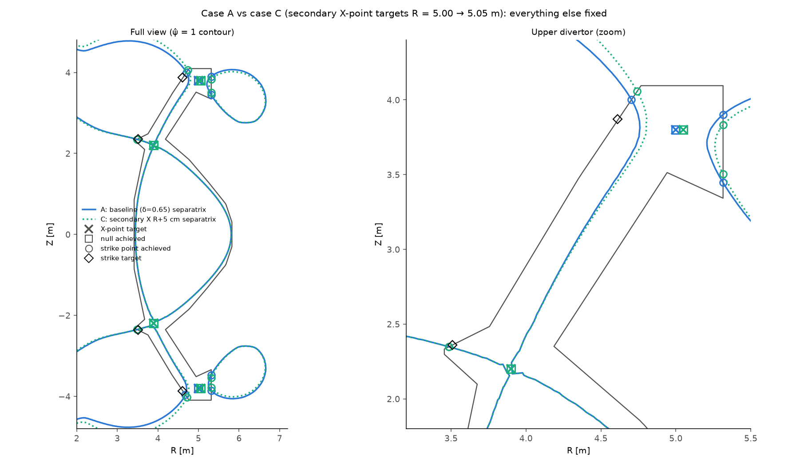
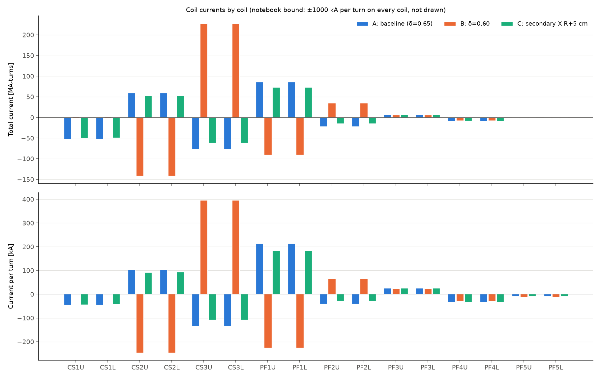

# ARC V3A: triangularity and secondary X-point targets vs coil currents

*Static free-boundary TokaMaker equilibria. Plasma profiles held fixed. No TORAX.*

**New here? Start with the [picture guide](picture_guide.html)** (interactive; open it in a browser).

## What I was trying to find out

Can the PF/CS coils change the plasma's triangularity while keeping the same primary and secondary
X-points and strike points? And when I move a secondary X-point, what has to give?

## What I did

I turned F. Sheehan's ARC V3A shape-testing notebook into a script that rebuilds his equilibrium unchanged, then ran it once
per case, each in a fresh process.

**What each case changed:**

| Case | Change from baseline |
|---|---|
| A | none (requested δ = 0.65) |
| B | requested δ = 0.60, which moves the boundary shape points it generates |
| C | secondary X-point targets moved from R = 5.00 to 5.05 m (saddle and isoflux points both move, as in the notebook) |

**Held fixed in every case:**
- **Plasma:** profiles (p′, FF′ shape), Ip = 12 MA, axis pressure 0.5 MPa.
- **Machine and other shape inputs:** mesh, a = 1.165, κ = 1.8.
- **Targets:** primary X-points (3.9, ±2.2), and the secondary X-points and strike-point targets
  (except in C).
- **Solver settings:** all constraint weights, coil bounds, regularization and solver settings.

**Checks before trusting the setup:**
- **Faithful copy:** the script's case A reproduces the saved notebook output *exactly*: κ 1.842,
  δ 0.587, q95 3.208, l_i 1.4194, volume 193.08 m³, and identical X-points and strike points. This is
  with OFT 26.9, even though the notebook used a v26.6 development build.
- **Repeatable:** 1-thread runs repeat bit-for-bit. A 4-thread run agrees with them to better than
  one part in a million. Multi-threaded runs vary in the last digits from run to run, so the cases use
  1 thread.

## What happened (observations)

All three cases **converged** (22–25 iterations) to a **diverted** equilibrium with all four nulls
present. Full table: [results/summary_by_case.md](results/summary_by_case.md). Coils:
[results/coil_currents_by_case.md](results/coil_currents_by_case.md).

| | A: δ req 0.65 | B: δ req 0.60 | C: secondary R+5 cm |
|---|---|---|---|
| δ achieved (OFT / from boundary / from X-point) | 0.587 / 0.584 / 0.615 | 0.577 / 0.568 / 0.605 | 0.587 / 0.583 / 0.615 |
| κ achieved (OFT / from boundary) | 1.842 / 1.827 | 1.844 / 1.824 | 1.841 / 1.826 |
| X-point misses, all four | ≤ 0.1 mm | ≤ 0.1 mm | ≤ 0.1 mm |
| ψ̂ at primary nulls (U / L) | 0.9999 / 1.0011 | 1.0006 / 1.0001 | 0.9999 / 1.0011 |
| ψ̂ at secondary nulls (U / L) | 1.0054 / 1.0077 | 1.0090 / 1.0101 | 1.0059 / 1.0081 |
| inner strike miss (U / L) | 2.7 / 2.2 cm | 8.7 / 9.3 cm | 2.7 / 2.1 cm |
| outer strike miss (U / L) | 16.1 / 11.2 cm | 9.2 / 5.0 cm | 22.8 / 18.8 cm |
| worst shape-point residual \|ψ̂−1\| | 0.035 | 0.043 | 0.035 |
| largest \|I\| per turn | 215 kA (PF1) | 396 kA (CS3) | 184 kA (PF1) |
| largest \|I\| / notebook bound | 0.21 | 0.40 | 0.18 |







### Experiment 1: triangularity 0.65 → 0.60

**Shape: a 0.05 request gives a 0.01–0.016 change.** Achieved δ drops by only 0.010 (OFT), 0.016
(measured from the boundary) or 0.010 (from the X-point position). κ is unchanged.

**Why so little moves.** Changing δ from 0.65 to 0.60 moves the 35 remaining shape points by only 2 cm
on average and 5 cm at most, mostly at the shoulders around (4.63, ±1.73) m. The 15 points nearest
the X-points, which would change most, are trimmed away.

**The X-points stay put.** All four stay within 0.1 mm of their targets. Their weights (saddle 100–1000,
isoflux 3–10) dominate the shape points (weight 1).

**Constraints that got worse:**
- **Shape points:** worst \|ψ̂−1\| grew from 0.035 to 0.043.
- **Inner strike points:** they slid 7–8 cm along the wall, from a 2–3 cm miss to a 9 cm miss.
- **Secondary nulls:** they moved further outside the separatrix, from ψ̂ ≈ 1.007 to 1.010 (average of
  upper and lower).

**What improved.** The outer strike points moved closer to their targets (16 → 9 cm upper).

**Coils: a huge swing for a tiny shape change.** CS3 went from −134 to +396 kA per turn, CS2 from +104 to
−246, and PF1 from +215 to −226. CS1 went to about zero. The outer coils PF3–PF5 barely changed
(≤ 4 kA per turn).

**The coil swing is a near-invisible combination.** I tested this directly ([results/coil_cancellation_check.json](results/coil_cancellation_check.json)).
Taken one coil pair at a time, the B−A current changes each shift the flux along the boundary targets
by 7.5–13.9 Wb/rad. That is as much as the entire baseline coil set (13.1 Wb/rad). Together they shift
it by only **0.40 Wb/rad**, and add less than 0.01 T of field at the X-points. So the CS2/CS3/PF1/CS1
changes almost cancel each other where the plasma is.

### Experiment 2: secondary X-points out 5 cm

**What stays the same:** the core plasma, primary X-points, inner legs and inner strike points. κ, δ and
q95 change by ≤ 0.003.

**The secondaries move exactly as asked.** They land on the new targets (≤ 0.1 mm) and sit slightly
further outside the separatrix (ψ̂ 1.0054 → 1.0059 upper).

**The outer legs follow, and miss the outer strike targets by more.** The outer legs move outward: the
outer strike points shift about 7 cm up and out along the wall, and their misses grow from 16/11 cm to
23/19 cm.

**The coil changes are small and targeted:** ≤ 31 kA per turn, mainly PF1 (−31), CS3 (+26), PF2 (+13)
and CS2 (−11). This change adds about 0.02 T at the secondary X-points and almost nothing (0.0002 T) at
the primaries, so it acts where it should. It still involves some cancellation between coils.

### Coil bounds and units (checked)

**Units.** TokaMaker's coil currents and `set_coil_bounds` are both in **A per turn**.

**Turn counts.** The mesh gives 1150 turns (CS1), 575 (CS2, CS3), 400 (PF1), 529 (PF2), 256 (PF3,
PF4) and 169 (PF5). The notebook comment says "100 turns", which is wrong.

**So the bounds are effectively off.** The notebook bound of ±1000 kA per turn on every coil equals
169–1150 MA-turns per coil.

**Comparison with the public ARC example.** In the public OFT ARC V3A example (same mesh, similar shape,
κ 1.88, δ 0.59, but 3.2 MPa axis pressure), every coil stays below 59 kA per turn. Case A needs up to
215 kA per turn and case B up to 396.

## What this means (interpretation, not yet tested)

1. **With the X-points pinned, triangularity is not really a free knob.** For a diverted plasma, δ is
   essentially set by how far inboard the X-point sits. Here that gives δ ≈ (R_geo − 3.9)/a ≈ 0.61–0.62.
   The requested δ = 0.65 would need an X-point at R ≈ 3.86 m (from the notebook's own `xpoints_from_moments` call).
   So the baseline already asks for two incompatible things, and the heavily weighted X-point wins.
   **That is why the baseline gives 0.587 rather than 0.65.**

2. **To test whether the coils can change δ, the X-points have to move with it.** Changing δ while
   holding the X-points fixed mostly tests how the solver resolves a conflict. It does not test what
   the coils can do.

3. **Coil currents from this setup are not unique.** Several coil combinations produce almost the
   same field at the plasma. The weak regularization (0.01) doesn't pick one firmly. So the A→B coil
   "changes" are mainly the solver drifting along a nearly free direction, not the cost of changing δ.
   Feasibility conclusions about coils need a better-conditioned problem first, for example stronger
   or more physical regularization, or real coil limits.

4. **The secondary null controls the outer legs, not the core.** Moving it 5 cm outward moves the
   outer legs and strike points with it, at small coil cost. The fixed outer strike targets then fit
   worse. **Secondary X-point and outer strike targets can't be chosen independently:** the strike
   point is where the leg from that null happens to hit the wall.

5. **None of the cases tells us about engineering feasibility yet.** Nothing failed, and nothing hit
   the bounds. But the bounds are not real limits, and the currents are 4–7× the public example's. A
   "no" could come from three different causes, which need telling apart:
   - **solver failure:** the iteration does not converge;
   - **conflicting constraints:** large residuals, as with δ vs fixed X-points here;
   - **physical or engineering limits:** real coil-current or field limits reached.
   None of the cases hit the first or third.

## What can and cannot be held fixed

| Category | Examples in this notebook | How it behaves |
|---|---|---|
| **1. I specify directly (inputs)** | Ip, axis pressure, profile shapes, a/κ/δ (only via the shape points), X-point targets, strike targets, weights, bounds, regularization | Exactly what I type |
| **2. TokaMaker tries to satisfy** | Isoflux points (boundary shape, strike points, X-points on the separatrix) and saddle points (nulls), all *soft*; coil bounds and Ip/pressure are *hard* | Met in a weighted compromise; conflicts show up as residuals |
| **3. Comes out of the solution** | Achieved δ, κ, a, R_geo, q95, l_i, ψ̂ at each null, strike points, coil currents, number and location of nulls | Can't be set directly; only steered through category 2 |

In this setup, the strong constraints (X-points, weights 100–1000) are effectively held fixed. Weaker
ones (shape points and strike points, weight 1) are what moves when targets conflict. **Achieved δ and
strike points are outputs.** Requesting them doesn't guarantee them.

## What is unresolved

- **Moving δ properly.** Would moving the primary X-points together with δ (e.g. from
  `xpoints_from_moments`) let the coils change δ by the full 0.05, and at what coil cost?
- **Regularization.** How sensitive are the coil currents to the regularization weights? Is there a
  "correct" regularization for ARC (target currents from a reference scenario)?
- **Real coil limits.** What are realistic ARC V3A PF/CS limits, in A per turn or field on the
  conductor? Without them, no case can be called feasible or infeasible.
- **Secondary-null placement.** How close to the separatrix should the secondary nulls be (ψ̂ gap
  0.005–0.010 here) for the intended configuration (X-point target or snowflake-like)?
- **Changing plasma conditions.** Everything here uses fixed, low-pressure profiles (0.5 MPa vs
  3.2 MPa in the public example). The TORAX phase will change this.

## Three questions for the next meeting

1. **Should δ and the X-points move together?** With the primary X-points pinned at R = 3.9 m (weight
   100) and trimming removing the shape points near the corners, requested δ barely matters
   (0.65 → 0.60 gives 0.587 → 0.577). For a δ scan, should I move the primary X-points with δ (e.g.
   from `xpoints_from_moments`), or treat X-point position itself as the variable instead of δ?

2. **How should the coil currents be regularized?** The A→B coil change (CS3 −134 → +396 kA per turn)
   is almost invisible at the plasma boundary: it changes the flux along the targets by only 3 % of the
   whole coil set's. That suggests the regularization (0.01) is too weak to give unique currents. Should
   I raise the weights, regularize toward a reference coil set, or use realistic limits? What are the
   right per-turn current limits for ARC V3A, given the mesh's 169–1150 turns?

3. **What ψ̂ gap do we want at the secondary nulls?** They sit at ψ̂ ≈ 1.005–1.010, slightly outside the
   separatrix. Moving them out 5 cm pushes the outer strike points 7 cm along the wall, away from their
   targets. Should the outer strike targets be dropped, or derived from the secondary-null position?
   And is the near-double-null setting (secondary isoflux weight 3) intended for the configuration
   we're studying?

## How to rerun

See [README.md](README.md). In short, from the repo root:

```
.venv/bin/python studies/arc_v3a_triangularity_and_secondary_xpoint/code/run_equilibria.py
.venv/bin/python studies/arc_v3a_triangularity_and_secondary_xpoint/code/check_coil_cancellation.py
.venv/bin/python studies/arc_v3a_triangularity_and_secondary_xpoint/code/build_picture_guide.py
```
