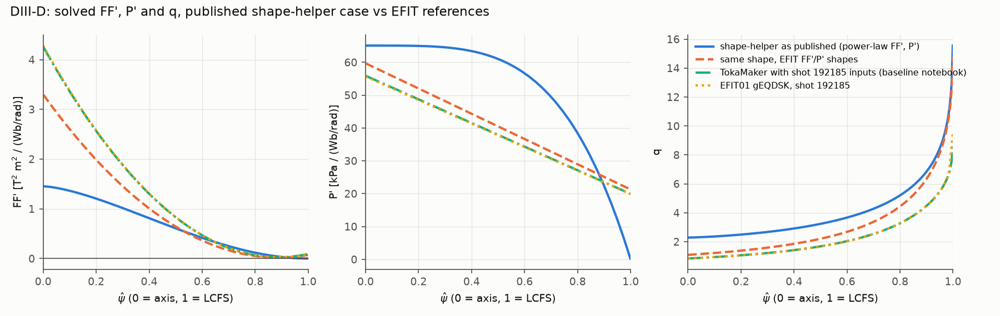
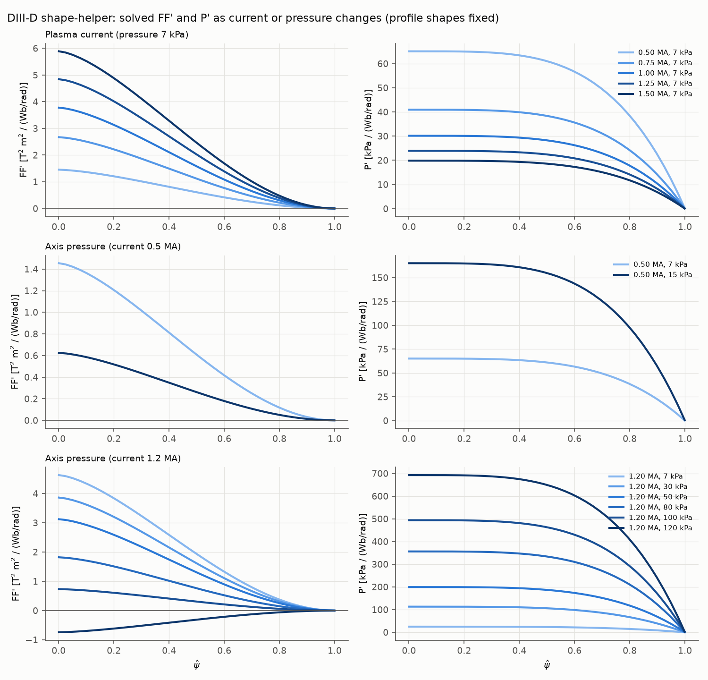
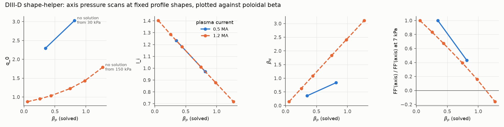
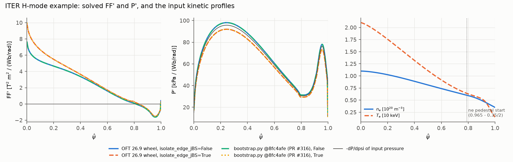

# Report: FF′ and P′ realism in OFT's DIII-D shape-helper and ITER H-mode examples

Steps 1–3 of the plan: metrics, reproduction of both examples, and a one-at-a-time DIII-D scan. The numbers
are in [results/summary.md](results/summary.md), and the method and inputs are in [README.md](README.md).
All results are from TokaMaker in the pinned environment (OpenFUSIONToolkit 26.9), with one thread.

## Short answer
- **The DIII-D example's FF′/P′ plot shows inputs, not results.** It shows the unitless power-law shapes before
  solving. TokaMaker only rescales those shapes, one factor for FF′ and one for P′, to hit the plasma current and
  axis pressure targets. The shapes themselves never change.
- **At the published operating point the profiles are plausible but too flat in the core.** That point is a
  0.5 MA, 7 kPa, β_p ≈ 0.35 plasma, taken from the real DIII-D shot 192185 in the same folder.
- **Under more realistic conditions the fixed shapes break down.** As pressure rises relative to current
  (higher β_p), the FF′ scale factor shrinks:
  - FF′ reaches zero everywhere at β_p ≈ 1.1.
  - Above that, FF′ is negative everywhere.
  - Above β_p ≈ 1.3 TokaMaker finds no solution, even with 300 iterations.

  Nothing in this family can produce a pressure pedestal or the edge bootstrap current that H-mode
  reconstructions show.
- **The ITER example's FF′/P′ are solved outputs with real H-mode features.** P′ has an edge pedestal peak, and
  FF′ is positive in the core and negative in the edge. That is the sense in which they are realistic. But the
  notebook's own realism claim is about the current profile, not FF′/P′. Its inductive current was tuned by hand
  to match a published total-current profile. Some of the FF′/P′ features are artifacts of how the input profiles
  were built, not of the solver (see below).

## 1. DIII-D: the published case against the real shot

| | q₀ | q₉₅ | l_i | β_p | FF′(0.5)/FF′(0) |
|---|---|---|---|---|---|
| shape-helper as published | 2.29 | 8.46 | 1.23 | 0.35 | 0.42 |
| same shape, EFIT profile shapes | 1.11 | 8.13 | 1.64 | 0.30 | |
| TokaMaker with shot 192185 inputs | 0.86 | 5.47 | 1.62 | 0.23 | 0.20 |
| EFIT01 file, shot 192185 | 0.84 | 5.48 | | | 0.19 |

- **The reference check works.** TokaMaker run with the shot's own inputs reproduces the EFIT q-profile and both
  profiles (q₀ 0.86 against 0.84, q₉₅ 5.47 against 5.48). So the unit and sign handling is right, and the
  reference is usable.
- **The q₉₅ gap comes from the plasma shape, not the profiles.** Putting the EFIT profile shapes onto the
  shape-helper boundary still gives q₉₅ 8.1.
- **The q₀ gap comes from the profiles.** The power-law FF′ falls to only 0.42 of its axis value by ψ̂ = 0.5;
  the real one falls to 0.19. So the made-up FF′ puts too little current on axis: q₀ is 2.3 instead of about 0.9.
- **P′ shape:**
  - The power law P′ = 1 − ψ̂⁴ is flat over the core and then drops to zero at the LCFS.
  - EFIT's P′ is close to linear and stays at about 36 % of its axis value at the edge.
  - Neither has a pedestal. This EFIT reconstruction uses magnetic measurements only and few profile terms,
    so it cannot show one.

## 2. DIII-D: one input at a time

- **Plasma current (0.5 → 1.5 MA at 7 kPa).** FF′ grows (axis value from 1.45 to 5.89) and P′ shrinks, but both
  keep their shapes exactly. q₉₅ falls from 8.5 to 2.7, and q₀ drops below 1 from 1.25 MA. l_i stays at
  1.35–1.41.
- **Axis pressure.** P′ rises with the pressure target. The current target is then met by shrinking the FF′
  scale factor:
  - The FF′ axis value falls in a straight line with β_p and crosses zero at β_p ≈ 1.1, between the converged
    cases at 0.98 and 1.27.
  - At 1.2 MA and 120 kPa (β_p 1.27, β_N 3.1), FF′ is negative everywhere. Its shape is the published one
    flipped upside down, so all the current comes from the pressure term.
  - l_i follows a single curve against β_p for both currents, from 1.40 down to 0.72. With fixed shapes, β_p
    alone sets l_i.
- **No solutions at higher β_p.** Cases fail at 0.5 MA from 30 kPa and at 1.2 MA from 150 kPa. Both are beyond
  β_p ≈ 1.3, and they also fail with 300 nonlinear iterations (table in `results/summary.md`). OFT's iteration
  log (its first column is the FF′ scale factor, from `grad_shaf.F90`) shows the cycle:
  1. The FF′ scale is driven ever more negative, to about −11 at 0.5 MA and 30 kPa.
  2. The magnetic axis moves outward from R = 1.81 to 2.07 m.
  3. The solve collapses and the cycle restarts.

  Some cases end instead with "Matrix solve failed for targets": 0.5 MA at 120 kPa (300 iterations) and
  1.2 MA at 200 kPa. The others hit the iteration limit.
- **Profile exponents (at 0.5 MA, 7 kPa).**
  - The FF′ exponents move q₀ between 1.4 and 4.1 and l_i between 0.85 and 1.61.
  - The P′ exponents move the ratio of edge to core P′ between 0.15 and 0.72, but it never exceeds 1. A monotone
    power law cannot make an edge pedestal.

**Why this counts as unrealistic.** At realistic H-mode conditions, which is a higher β_p (DIII-D's
high-poloidal-beta scenarios run above 2), these inputs fail in two ways:
1. **FF′ can only be rescaled as a whole.** It goes from all-positive, through zero, to all-negative, and then has
   no solution at all. Reconstructions with bootstrap current, like the ITER example below, instead keep FF′
   positive in the core and negative only in the edge.
2. **P′ cannot have a pedestal.** It always falls to zero at the separatrix.

These results do not show where real DIII-D equilibria sit in that range. That needs a kinetic EFIT reference,
which is not in OFT.

## 3. ITER H-mode example

| | q₀ | q₉₅ | l_i | β_N | FF′ zero crossings (ψ̂) | min FF′ |
|---|---|---|---|---|---|---|
| isolate_edge_jBS = False | 1.30 | 3.48 | 1.02 | 1.98 | 0.81, 1.00 | −1.61 at ψ̂ 0.96 |
| isolate_edge_jBS = True | 1.04 | 3.44 | 1.09 | 1.88 | 0.83, 1.00 | −1.51 at ψ̂ 0.96 |

- **The derivative fix (OFT PR #316) changes nothing that matters here.** With and without it, q, l_i and β_N
  agree to 0.01, and the FF′ zero crossing moves by 0.001. So the wheel's older `bootstrap.py` does not cause
  any of the features below.
- **The solved P′ is the input pressure's own gradient.** It matches −dP/dψ of the input kinetic pressure (grey
  line) to within 2.7 % for ψ̂ between 0.02 and 0.98. So every P′ feature comes from the inputs:
  - **P′ → 0 on axis.** `Hmode_profiles` (an OMFIT function, "evenly spaced in your favorite radial coordinate")
    is evaluated directly on ψ̂. Its core shape is flat in ψ̂ at ψ̂ = 0, so P′ there is zero. A profile that is
    smooth in minor radius would give a finite P′ on axis, because ψ̂ grows roughly as radius squared near the
    axis.
  - **Kink at ψ̂ = 0.79.** That is where the density pedestal starts (0.965 − 0.35/2). A density pedestal 0.35
    wide in ψ̂ is very wide; typical pedestals are a few percent of ψ̂.
  - **Pedestal peak in P′ at ψ̂ ≈ 0.96.** This is the intended H-mode feature.
- **FF′ follows from the current constraint.**
  - The negative well at ψ̂ ≈ 0.82–1.0 comes from the bootstrap current in the pedestal. This is the realistic
    H-mode feature.
  - The spike on axis (7.5, or 9.8 with the edge isolated) is the other side of P′ → 0. With no pressure current
    on axis, FF′ alone has to carry the specified axis current density.
- **The axis pressure is 740 kPa, not the notebook's 620 kPa target.** `solve_with_bootstrap` builds pressure
  from the kinetic profiles (2·e·1.1×10²⁰ m⁻³·21 keV = 740 kPa).
- **Global values are near ITER's baseline design but not on it.** q₉₅ is 3.4–3.5 against about 3, and β_N is
  1.9–2.0 against about 1.8. l_i is not directly comparable because the normalizations differ.

## Limitations
- One reference shot, 192185, at low current and pressure. Its EFIT01 reconstruction has no edge information.
- The β_p at which FF′ flips sign and at which solutions stop depends on the chosen shape, coils and
  regularization. The values here hold for the shape-helper setup only.
- The 1.2 MA pressure scan changes two inputs from the published case.
- Not yet done: steps 4–5 of the plan (H-mode profiles on DIII-D, and ITER sensitivity to pedestal width,
  sampling and the radial coordinate).
